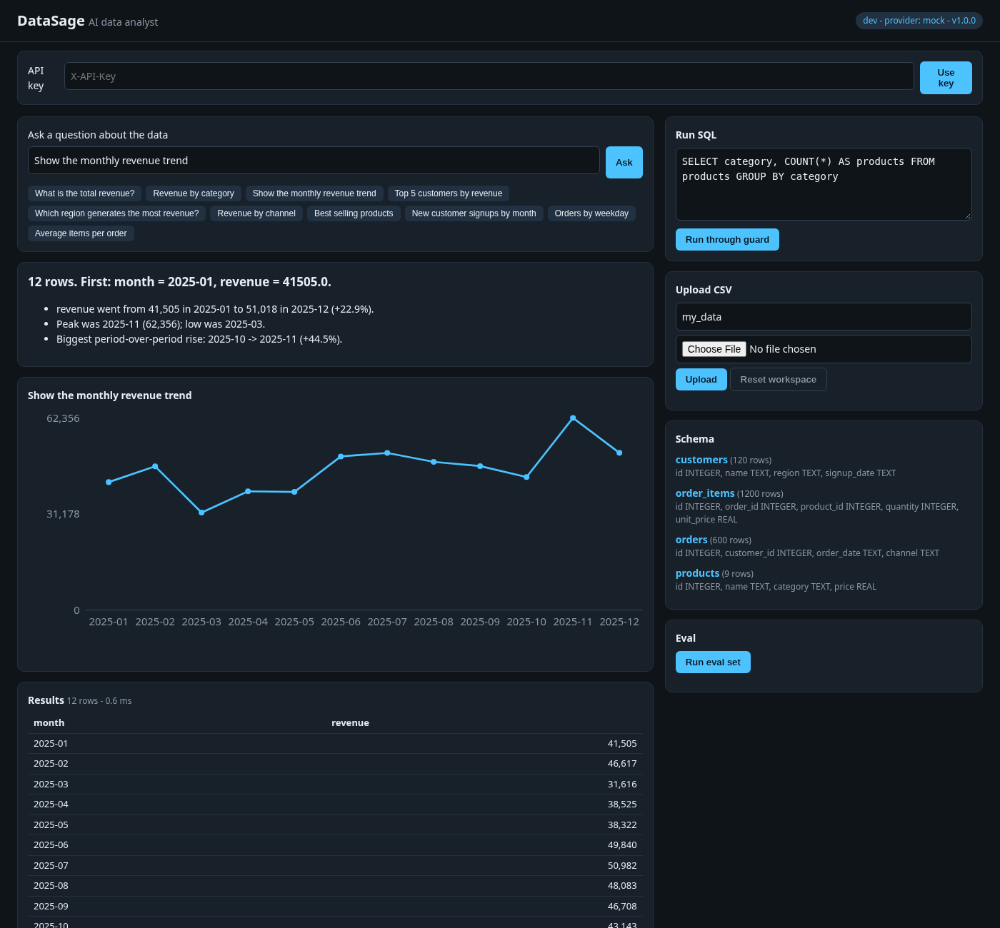
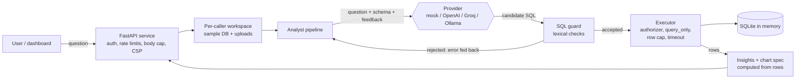
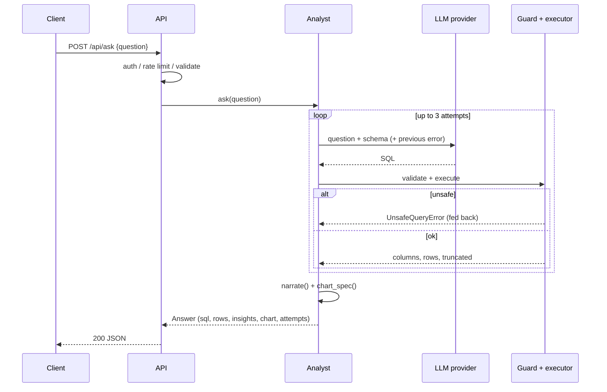
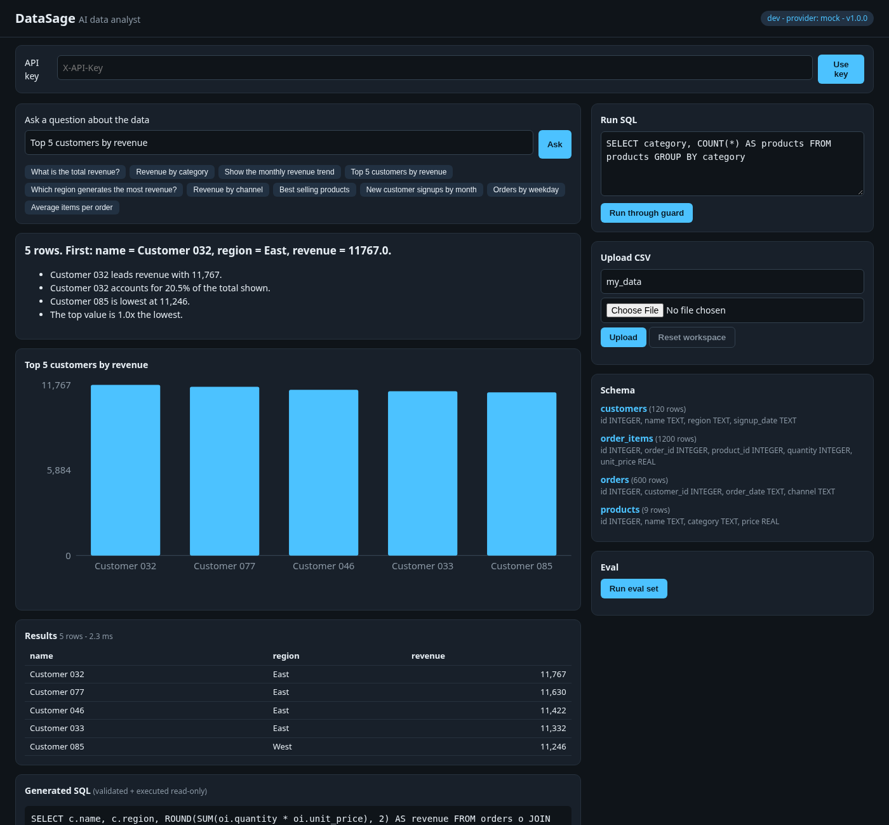
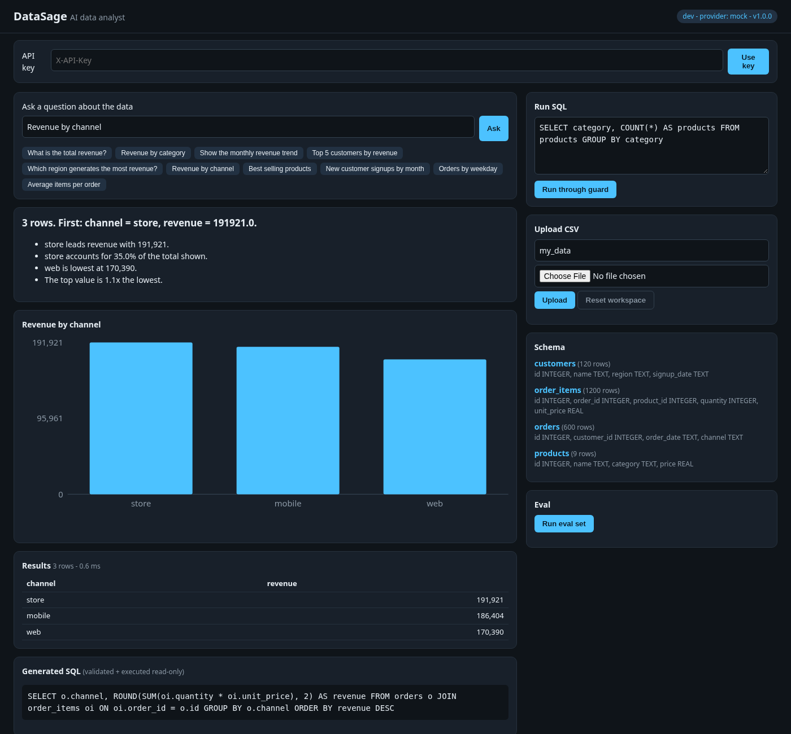

# DataSage - AI Data Analyst Agent

[](https://github.com/bharatkumar00797/datasage-ai-analyst/actions/workflows/ci.yml)


**DataSage is an AI agent that works as a data analyst.** Ask a business question in plain
English ("monthly revenue trend", "top 5 customers by revenue") and an LLM writes the SQL.
DataSage treats that SQL as untrusted, checks it with a layered read-only guard, runs it
against SQLite, then describes the result and picks a chart. All the numbers in the
explanation come from the returned rows, not from the model.

It works fully offline by default with a deterministic **mock** provider, so the demo, tests
and every deployment run without paid keys. Any OpenAI-compatible API (OpenAI, Groq, Ollama)
can be plugged in.



## The problem

Business teams keep asking analysts the same kind of question, and text-to-SQL with an LLM
looks like an easy fix. Running model-written SQL directly against a database is risky, though:

- The model can produce `DROP`, `DELETE`, `ATTACH` or `PRAGMA`. A prompt-injected question can
  ask for that on purpose.
- A valid `SELECT` can still read tables you never meant to expose, or a recursive CTE can
  run forever.
- When an LLM summarises the result, it can invent numbers.

DataSage puts the LLM behind deterministic controls. The model only proposes SQL, the guard
decides whether it runs, and plain code computes the insights.

## Features

- **Guarded text-to-SQL**: a lexical validator plus the SQLite authorizer allow only `SELECT`
  on allowlisted tables, on a `query_only` connection with a row cap and a timeout.
- **Self-correction**: when the guard rejects a query, the error goes back to the model,
  which gets up to 2 more attempts. Timeouts are never retried.
- **Deterministic insights**: for time series, the change from first to last period, the peak
  and low, and the biggest move between periods; for categories, the leader, its share of the
  total, the lowest category and the top/bottom ratio.
- **Automatic charts**: `line` for time series, `bar` for up to 25 categories, `metric` for a
  single value, otherwise `table`.
- **CSV upload**: a CSV becomes a new read-only table in your own workspace (1 MB / 20k rows /
  50 columns, cleaned-up identifiers, parameterised inserts).
- **Eval set**: 15 questions with hand-written gold SQL, scored by execution accuracy
  (the mock scores 15/15).
- **REST API + dashboard**: FastAPI with OpenAPI docs and a static dashboard with no build
  step (question box, SQL view, SVG chart, insights, results table, raw SQL, upload, schema,
  eval).
- **Deploy anywhere**: Docker, hardened docker-compose, Render, Fly.io, Railway, Vercel.

## Architecture





## How it works

1. **Schema prompt**: the allowlisted tables and columns (sample data plus your uploads) are
   described to the provider.
2. **Generate**: the provider returns SQL. The mock matches 15 intents to vetted SQL and
   handles `show <table>` / `how many rows in <table>` for uploads. Real models run at
   temperature 0, and fenced SQL is extracted from the reply.
3. **Guard**: comments are stripped and string literals masked. The query must be a single
   `SELECT`/`WITH` statement of at most 4000 characters with no forbidden keywords
   (`INSERT`, `DROP`, `ATTACH`, `PRAGMA`, ...) or functions (`load_extension`, `readfile`, ...).
4. **Execute**: a SQLite authorizer allows only SELECT/READ/FUNCTION/RECURSIVE on allowlisted
   tables (`sqlite_master` is denied). The connection is `PRAGMA query_only`, the query is
   wrapped in `LIMIT max_rows+1` to set a `truncated` flag, and a progress handler stops it
   after the timeout.
5. **Self-correct**: if step 3 or 4 rejects the query, the rejected SQL and the error go back
   to the model for up to 2 retries. Every attempt is recorded in `attempts`.
6. **Explain**: `narrate()` finds the label and measure columns and writes insights from the
   rows. `chart_spec()` picks the chart type.

## Security model

| Layer | Control |
| --- | --- |
| Model output | Always untrusted; never executed without the guard |
| Lexical guard | Single statement, SELECT/WITH only, keyword + function blocklist, length cap |
| Engine | SQLite authorizer allowlist (actions + tables), `query_only`, in-memory DB |
| Resources | Row cap + truncated flag, progress-handler timeout (no retry on timeout) |
| Insights | Numbers computed from rows; the model never writes the explanation |
| Uploads | Size/row/column caps, UTF-8, no NUL, sanitised identifiers, reserved names rejected, parameterised inserts |
| HTTP | API keys (sha256 + constant-time compare), sliding-window rate limits (general / ask / upload), pydantic `extra=forbid` + length caps, 1.2 MB body cap (header and streamed), strict CSP + security headers, `no-store`, env-driven CORS |
| Public demo | Mock provider forced, one private workspace per client (hashed IP), workspace and upload caps |
| Container | Non-root uid, read-only rootfs, tmpfs `/tmp`, `cap_drop: ALL`, `no-new-privileges`, pids/mem/CPU limits |

**Residual risks** (stated honestly):

- An allowed `SELECT` can still return any row of an allowlisted table. Only expose data that
  callers may see.
- Prompt injection can make the model write the *wrong* read-only query. The guard limits the
  damage, but it cannot judge intent.
- Behind a reverse proxy without `DATASAGE_TRUST_PROXY=true`, all public-demo visitors share
  one identity (one workspace and one rate-limit bucket). With it set, trust only proxies you
  control.
- State lives in memory: uploads are lost on restart, and on serverless they may not survive
  between requests.
- Raw SQL (`/api/sql`) is available to every caller. It goes through the same guard, which is
  the actual safety boundary.

## Providers

| Provider | Settings |
| --- | --- |
| mock (default) | `DATASAGE_PROVIDER=mock`; offline, deterministic |
| OpenAI | `DATASAGE_PROVIDER=openai`, `DATASAGE_LLM_API_KEY`, `DATASAGE_LLM_MODEL=gpt-4o-mini` |
| Groq | `DATASAGE_PROVIDER=openai`, `DATASAGE_LLM_BASE_URL=https://api.groq.com/openai/v1`, key, e.g. `llama-3.3-70b-versatile` |
| Ollama | `DATASAGE_PROVIDER=openai`, `DATASAGE_LLM_BASE_URL=http://localhost:11434/v1`, model e.g. `qwen2.5-coder` |

Public-demo mode always uses the mock, whatever the environment says.

## Quickstart

```bash
git clone https://github.com/bharatkumar00797/datasage-ai-analyst.git
cd datasage-ai-analyst
python -m venv .venv && source .venv/bin/activate
pip install -e ".[dev]"

datasage ask "monthly revenue trend"
datasage ask "top 5 customers by revenue" --json
datasage sql "SELECT region, COUNT(*) FROM customers GROUP BY region"
datasage sql "DROP TABLE orders"            # blocked, exit code 2
datasage ask "how many rows in stores" --csv stores=stores.csv
datasage schema
datasage eval --min-accuracy 0.9
datasage serve --dev                        # dashboard on http://127.0.0.1:8000
```

## API reference

Interactive docs are at `/docs` (OpenAPI at `/openapi.json`).

| Method | Path | Purpose |
| --- | --- | --- |
| GET | `/healthz` | Liveness + version |
| GET | `/api/config` | Access mode, provider name, limits (never credentials) |
| GET | `/api/examples` | Example questions |
| GET | `/api/schema` | Tables in your workspace (`uploaded` flag) |
| POST | `/api/ask` | `{"question"}` -> sql, columns, rows, truncated, insights, chart, attempts |
| POST | `/api/sql` | `{"sql"}` -> guarded raw query result + insights + chart |
| POST | `/api/datasets` | `{"name","csv"}` -> new table (201) |
| DELETE | `/api/datasets` | Reset your workspace (204) |
| POST | `/api/eval` | Run the eval set on a clean sample DB |

**Access modes**

| Mode | When | Behaviour |
| --- | --- | --- |
| api-key | `DATASAGE_API_KEYS` set | `X-API-Key` or `Authorization: Bearer` required on `/api`; configured provider |
| dev | `DATASAGE_DEV_MODE=true` / `serve --dev` | No auth; localhost only |
| public-demo | neither | Anonymous, mock provider only, private workspace per client |

**Errors**: 401 missing/invalid key, 408 query timeout, 409 upload limit reached, 413 body too
large, 422 blocked SQL / invalid input / unanswerable question, 429 rate limited (with
`Retry-After`), 502 LLM provider error.

## Deploy

All targets serve the same image or app. Without `DATASAGE_API_KEYS` you get a public demo.

**Docker**

```bash
docker build -t datasage .
docker run --rm -p 8000:8000 --read-only --tmpfs /tmp --cap-drop ALL \
  --security-opt no-new-privileges datasage
python3 scripts/smoke_test.py http://127.0.0.1:8000
```

**docker-compose** (hardened): `docker compose up --build --wait`. It reads an optional `.env`;
`DATASAGE_HOST_PORT` changes the host port.

**Render**: New -> Blueprint -> this repo. `render.yaml` deploys the Dockerfile with
`/healthz` checks. Add secrets (`DATASAGE_API_KEYS`, provider key) in the dashboard.

**Fly.io**: `fly launch --copy-config --no-deploy && fly deploy` (`fly.toml`: port 8080,
region `bom`). Secrets: `fly secrets set DATASAGE_API_KEYS=...`.

**Railway**: New project -> Deploy from GitHub repo. `railway.json` uses the Dockerfile,
`/healthz` and restart on failure.

**Vercel**: import the repo. `vercel.json` routes everything to `api/index.py` (FastAPI as a
Python function). Every endpoint is a short synchronous request; uploads are per instance and
may disappear between requests.

## Configuration

| Variable | Default | Description |
| --- | --- | --- |
| `DATASAGE_PROVIDER` | `mock` | `mock` or `openai` (any OpenAI-compatible API) |
| `DATASAGE_LLM_BASE_URL` | `https://api.openai.com/v1` | Provider base URL |
| `DATASAGE_LLM_API_KEY` | empty | Provider API key (env only, never returned) |
| `DATASAGE_LLM_MODEL` | `gpt-4o-mini` | Model name |
| `DATASAGE_MAX_ROWS` | `500` | Row cap per query |
| `DATASAGE_QUERY_TIMEOUT_MS` | `2000` | Query timeout |
| `DATASAGE_API_KEYS` | empty | Comma-separated API keys; enables api-key mode |
| `DATASAGE_DEV_MODE` | `false` | No auth (localhost only) |
| `DATASAGE_CORS_ORIGINS` | empty | Comma-separated allowed origins |
| `DATASAGE_RATE_LIMIT_PER_MINUTE` | `120` | General requests per client per minute |
| `DATASAGE_ASK_LIMIT_PER_MINUTE` | `30` | ask / sql / eval per client per minute |
| `DATASAGE_UPLOAD_LIMIT_PER_MINUTE` | `10` | CSV uploads per client per minute |
| `DATASAGE_TRUST_PROXY` | `false` | Use the right-most `X-Forwarded-For` hop |
| `DATASAGE_MAX_WORKSPACES` | `200` | Workspaces kept in memory (oldest evicted) |
| `DATASAGE_MAX_UPLOADS` | `5` | Uploaded tables per workspace |
| `DATASAGE_HOST_PORT` | `8000` | Host port (docker-compose only) |
| `PORT` / `HOST` | `8000` / `127.0.0.1` (`0.0.0.0` in the container) | Listen address for `datasage serve` |

## Project layout

```
src/datasage/
  analyst.py      question -> SQL -> guard -> rows -> insights, retry loop
  sqlguard.py     lexical validator + authorizer executor (row cap, timeout)
  providers.py    mock + OpenAI-compatible providers
  insights.py     result shape, narration, chart spec
  upload.py       CSV -> validated read-only table
  dataset.py      deterministic retail sample data (seed 42)
  evals.py        execution-accuracy eval (data/eval_set.json)
  cli.py          datasage ask | sql | schema | eval | serve
  api/            FastAPI app, settings, auth + rate limits, middleware, workspaces, static dashboard
api/index.py      Vercel entrypoint
scripts/          smoke_test.py (stdlib end-to-end check)
tests/            pytest suite
```

## Testing

```bash
ruff check . && ruff format --check . && mypy && pytest
```

CI runs this on Python 3.11, 3.12 and 3.13, then builds the hardened container with
`docker compose up --wait` and runs `scripts/smoke_test.py` against it.

## Screenshots

| Top customers | Revenue by channel |
| --- | --- |
|  |  |

## Roadmap

- PostgreSQL / DuckDB backends with read-only roles
- Column-level allowlists and row-level filters per API key
- Multi-turn follow-up questions
- Persistent workspaces (SQLite file or object storage)

## License

[MIT](LICENSE)
